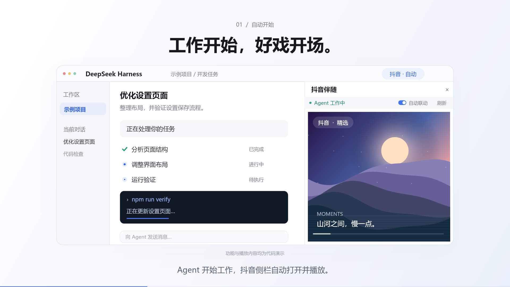

# DSH 抖音伴随

**Agent 工作时播放，审核时暂停，继续后续播，任务完成后暂停。**

[GitHub](https://github.com/ericlee041769-hash/dsh-douyin-companion) · [Gitee](https://gitee.com/sensenlee/dsh-douyin-companion)



[观看 45 秒宣传片](https://github.com/ericlee041769-hash/dsh-douyin-companion/releases/download/v0.2.3/dsh-douyin-companion-16x9.mp4) · [宣传片源码](promo/README.md)

基于 [zhangCzhe/dsh-slackoff](https://github.com/zhangCzhe/dsh-slackoff) 改造。适配 DSH Desktop 0.2.0-rc.2 的侧栏、会话状态与浏览器接口。

## 使用

安装后，对话标题栏出现「抖音 · 自动」。Agent 开始运行时，右侧自动打开抖音。

| 场景 | 行为 |
|---|---|
| 当前会话或其子 Agent 运行 | 打开侧栏并播放 |
| 需要审核、回答或其他人工操作 | 暂停所有视频，显示提示蒙版；在原对话区处理 |
| 人工操作结束且 Agent 继续运行 | 从暂停位置续播 |
| 任务完成、停止或连接断开 | 暂停 |
| 切换会话、隐藏视频页 | 暂停隐藏的视频 |

侧栏顶部有「自动联动」开关和刷新按钮。首次有声播放被浏览器拦截时，会静音播放，点击「开启声音」即可。抖音的登录、推荐与页面交互在原网页中完成。

**0.2.3：新建对话复用抖音登录态。** 插件在所有对话、工作区之间共用自己的浏览器存储；每个页面独立管理播放和释放。升级到 0.2.3 后需要登录一次。DSH Desktop 0.2.0-rc.2 的浏览器接口只提供进程内存储，退出并重新打开 DSH 后需要重新登录。

## 安装

从 [GitHub Release](https://github.com/ericlee041769-hash/dsh-douyin-companion/releases/tag/v0.2.3) 下载 `dsh-douyin-companion-0.2.3.tgz`，在 DSH 的「插件」页添加该文件的绝对路径。安装器如提示需要重启，请先结束正在运行的任务。

也可从 GitHub 或 Gitee 克隆源码后打包：

```sh
npm ci
npm test
npm run build
npm pack
```

## 保留的模块

- `src/activity.js`：从当前会话及子 Agent 的状态得出播放动作，审核优先于运行；其他会话与分叉不会干扰。
- `src/media.js`：在抖音页面控制实际视频，暂停保留进度，阻止等待审核时页面自行重播；识别直播 MediaStream 更换，隔离过期播放请求。切流取消不再弹错，已经播放的直播不重复启动。
- `src/client.jsx`：注册 DSH 原生侧栏，订阅状态，共用抖音登录存储，按页面管理创建、保持与释放，显示审核提醒。
- `src/style.css`：侧栏工具条及审核提示。
- `index.js` / `cordis.patch.yml`：DSH 加载插件所需入口；不注册模型工具或修改提示词。

## 已移除的路径

Chrome 扩展、独立弹窗、画中画、Host HTTP 状态端点、跨会话计数器、多网站配置、复杂任务筛选，以及对应的旧测试和构建脚本。桌面版仅保留当前需要的抖音侧栏联动。

0.2.3 移除按工作区／对话分配抖音登录存储的路径，以及不再需要的 `workspaces` 服务依赖。

## 验证

18 项客户端、状态与播放器测试覆盖：插槽共存与卸载、审批暂停与恢复、结束暂停、子 Agent 审核、跨会话隔离、共享登录存储与独立页面释放、断线、隐藏视频、延迟播放竞态、换视频、静音自动播放、直播切流取消、过期结果隔离与释放。

桌面实测结果见 [VERIFICATION.md](VERIFICATION.md)。

上游出处与基线提交见 [UPSTREAM.md](UPSTREAM.md)。保留原 MIT 许可证。
